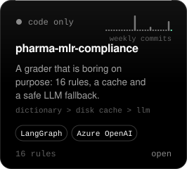

Read this page as plain text

 

**Sriram Kolli.** Backend-focused full-stack engineer in Bengaluru, India. Final-year B.Tech in Computer Science and Information Technology (SRKR Engineering College, 2023 to 2027). I build FastAPI and PostgreSQL services, agentic AI pipelines and workflow automation. Open to software engineering internships and entry-level backend or full-stack roles, in Bengaluru or remote.

**Experience**

- Zennith AI, Full Stack Developer Intern, Sep 2025 to now (paused Jun to Jul 2026 for Accenture): a document-extraction pipeline on FastAPI and Next.js components for upload and results.
- Accenture, Associate Software Engineer Intern, Jun to Jul 2026: CI/CD for FastAPI and PostgreSQL services, then an agentic pharma compliance review system.
- PixelTests, Software Development Intern, Dec 2024 to May 2025: a WhatsApp support pipeline that cut manual tickets by 80%. Employer numbers are my word.

**Projects**

- [LeaveFlow](https://github.com/sriram36/LeaveFlow) ([live](https://leave-flow-cyan.vercel.app)): leave requests over WhatsApp, approvals on a web dashboard. FastAPI, PostgreSQL, WebSockets, Next.js. 29 backend tests.
- [FinSight](https://github.com/sriram36/FinSight) ([live](https://finsight-wine-tau.vercel.app)): money advice where the model never does the arithmetic. A verifier checks every number against cited transactions. 60 tests.
- [pharma-mlr-compliance](https://github.com/sriram36/pharma-mlr-compliance): a rule-based grader, 16 rules, one optionally LLM-assisted. Lookups go dictionary, then disk cache, then LLM.

**Stack.** Languages: Python, TypeScript, JavaScript, Java, SQL. Backend: FastAPI, Django, Node.js, PostgreSQL, WebSockets, JWT, Pytest. Frontend: Next.js, React, Tailwind CSS. Ai: LangGraph, Azure OpenAI, RAG, LLM evaluation. Tools: Docker, Git, Playwright, n8n.

**Latest pushes.** [Portfolio](https://github.com/sriram36/Portfolio) | [Scout](https://github.com/sriram36/Scout) | [pharma-mlr-compliance](https://github.com/sriram36/pharma-mlr-compliance) | [FinSight](https://github.com/sriram36/FinSight) | [RefillCare](https://github.com/sriram36/RefillCare)

**Contact.** kollisriram6@gmail.com | [LinkedIn](https://www.linkedin.com/in/sriram-kolli-979723219) | [Portfolio](https://portfolio.kollisriram6.workers.dev)

Generated by <a href="build.py">build.py</a> and rebuilt every Monday by a GitHub Action.

